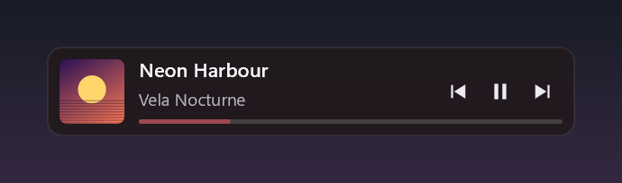

# MiniBar

*[Read this in English](README.md)*

Mini player musicale nativo per Windows 11: una barretta overlay che legge le API media
di sistema (SMTC), controlla la riproduzione e alleggerisce il player minimizzandolo.

> L'interfaccia dell'applicazione è in inglese: le voci di menu citate qui sotto sono
> quelle che si vedono davvero, con la traduzione fra parentesi quando serve.

Funziona con qualunque applicazione registri una sessione media di sistema — Spotify,
Tidal, YouTube Music nel browser, foobar2000, il lettore di Windows — senza account, API
key o plugin: MiniBar riconosce il player dalla sessione SMTC attiva e da lì risale al suo
processo, alla sua levetta nel mixer e alla sua finestra.

L'idea, i vincoli, il budget prestazioni e il perché delle scelte di progetto stanno in
[docs/design.md](docs/design.md). Questo file spiega solo come si compila e si usa.

## Requisiti

Nessuno. Non serve Visual Studio, non serve il Windows SDK installato, non servono
privilegi di amministratore: la toolchain vive dentro `tools\` ed è portable, come
l'applicazione.

## Compilare

```powershell
.\build.ps1                 # Release (default)
.\build.ps1 -Config debug
.\build.ps1 -Clean          # riparte da zero
```

L'eseguibile finisce in `dist\minibar.exe`. È autosufficiente: CRT statica, nessun
VC Redist, nessuna DLL accanto.

## Ricostruire la toolchain

`tools\` è già popolata. Per rifarla da zero su un'altra macchina, in quest'ordine:

```powershell
# 1. PowerShell 7 portable (serve per parsare il manifest VS da 29 MB)
curl.exe -sSL -o pwsh.zip https://github.com/PowerShell/PowerShell/releases/latest/download/PowerShell-7.6.5-win-x64.zip
Expand-Archive pwsh.zip -DestinationPath tools\pwsh

# 2. MSVC + Windows SDK, estratti dai pacchetti ufficiali Microsoft
tools\pwsh\pwsh.exe -File tools\get-msvc.ps1

# 3. CMake e Ninja: zip ufficiali estratti in tools\cmake e tools\ninja
```

`tools\get-msvc.ps1` legge il channel manifest di Visual Studio 2022, scarica i `.vsix`
di MSVC e gli `.msi` del Windows SDK e li estrae (`msiexec /a`, che non richiede
elevazione). Niente installer, niente registro, niente file fuori dalla cartella del progetto.
`tools\get-sdk-extra.ps1` aggiunge altri MSI dell'SDK se dovessero servire.

`tools\_dl\` è solo cache di download: si può cancellare (~2 GB) senza rompere nulla.

Per usare la toolchain a mano in una shell:

```powershell
. .\tools\env.ps1     # imposta INCLUDE, LIB, PATH
```

## Configurazione

Al primo avvio `minibar.exe` crea `minibar.ini` accanto a sé (quindi in `dist\`).

```ini
[general]
mode=overlay          ; overlay | docked | taskbar
theme=auto            ; auto | dark | light — auto segue il tema delle applicazioni
                      ; di Windows e lo cambia a caldo; sopra un gioco può convenire
                      ; forzare dark a prescindere
preferred_app=Spotify ; sottostringa del SourceAppUserModelId della sessione preferita;
                      ; vuoto = segui la sessione corrente di sistema. Si sceglie anche
                      ; dal menu: tasto destro → Player

[overlay]
layout=bar            ; bar (barretta orizzontale) | tile (riquadro con la copertina)
bar_width=266         ; larghezza della barretta in DIP, 168-840
tile_size=92          ; lato del riquadro in DIP, 68-224
x=…  y=…              ; scritti al rilascio del drag
idle_opacity=140      ; 0-255, opacità a riposo

[docked]
edge=bottom           ; bottom | top | left | right

[taskbar]
anchor=auto           ; auto | left | center | right
                      ; auto: a sinistra se le app sono al centro,
                      ;       al centro se le app sono a sinistra

[player]              ; si chiamava [spotify] fino alla 1.0: i vecchi INI si leggono ancora
auto_minimize=1       ; minimizza il player all'avvio di MiniBar
hide_instead=0        ; 1 = SW_HIDE invece di SW_MINIMIZE (più aggressivo)
launch_if_missing=0   ; avvia il player se non è in esecuzione
launch_path=          ; eseguibile da avviare; vuoto = percorsi tipici dedotti dal nome
pause_on_switch=1     ; cambiando player dal menu, mette in pausa quello che si lascia

[volume]
wheel_step=4          ; punti percentuali di volume per scatto di rotellina, 1-25

[hotkey]
enabled=0
modifiers=alt+shift
key=M
```

## Le tre modalità

Nel menu si chiamano **Overlay**, **Docked to an edge** (agganciata a un bordo) e
**In the taskbar** (dentro la taskbar); i due aspetti dell'overlay sono **Bar** (barretta) e
**Tile** (riquadro).

| | Overlay | Agganciata al bordo | Dentro la taskbar |
|---|---|---|---|
| Posizione | libera, trascinabile | striscia su un bordo dello schermo | nello spazio vuoto della taskbar |
| Spazio riservato | no | sì, le finestre massimizzate la rispettano | no |
| Click-through a riposo | sì | no | no |
| Opacità a riposo | ridotta (`idle_opacity`) | piena | piena |
| Controlli | all'hover | sempre | sempre |
| Sopra i giochi | sì | no | sì, finché la taskbar è visibile |
| Aspetti disponibili | barretta o riquadro | barretta | pillola compatta |
| Ingombro predefinito | 266×45 o 92×92 DIP | 45 DIP di altezza | altezza della taskbar |



In modalità taskbar la pillola mostra a riposo solo copertina, comandi e progress;
passandoci sopra si allarga e compaiono titolo e artista. Segue altezza, bordo, DPI e
tema della taskbar, e sparisce insieme a lei quando si nasconde o quando parte un'app a
schermo intero.

Si cambia modalità e aspetto dal menu col tasto destro (**Mode** e **Look**), o dall'icona
nella tray.

## Uso

| Azione | Come |
|---|---|
| Mostrare i controlli | passare il mouse sopra la barretta |
| Play/pausa, precedente, successivo | click sui pulsanti |
| Seek | click sulla progress bar (se il player lo consente) |
| Spostare la barretta | trascinarla (solo in overlay); la posizione si salva |
| **Alzare/abbassare il volume del player** | **rotellina del mouse sopra la barretta** |
| **Mute del player** | **click col tasto centrale sulla barretta** |
| Cambiare larghezza | **Ctrl** + rotellina sopra la barretta (solo in overlay), oppure `bar_width` / `tile_size` nell'INI |
| Cambiare modalità o aspetto | tasto destro → **Mode** (modalità) / **Look** (aspetto) |
| Scegliere quale player seguire | tasto destro → **Player** (elenca le sessioni attive, più **Automatic**); quello che si lascia va in pausa |
| Menu | tasto destro sulla barretta o sull'icona nella tray |
| Mostrare/nascondere | doppio click sull'icona nella tray, o hotkey se attiva |

La rotellina (volume e ridimensionamento) dipende dall'impostazione di Windows "scorri le
finestre inattive quando ci passo sopra", attiva per impostazione predefinita.

### Il volume è quello del player, non quello di sistema

MiniBar muove la levetta del player nel mixer di Windows (`ISimpleAudioVolume` sulla
sessione audio del processo), quindi il volume degli altri programmi non si tocca. Quale
sia il processo lo dice la sessione SMTC in corso: il suo `SourceAppUserModelId` viene
confrontato col proprietario di ogni sessione del mixer, per nome dell'eseguibile o per
AUMID se l'app è impacchettata. Se il player non ha una sessione audio — non è in
esecuzione, oppure non ha ancora emesso un suono — non c'è niente da muovere e la
rotellina torna a ridimensionare la barretta come prima, senza Ctrl. Il livello si mostra
per un secondo e mezzo sulla striscia della progress bar, in chiaro invece che in verde:
nessun pannello che compare, nessun pixel in più occupato.

Le interfacce Core Audio si creano al primo uso della rotellina, non all'avvio, e la
sessione trovata resta in cache finché non scade o finché non cambia il player in ascolto:
chi non tocca mai il volume non paga niente, né in memoria né in thread.

Chiudendo MiniBar la finestra del player viene **sempre** ripristinata. Se un'esecuzione
precedente è morta male con la finestra nascosta, il ripristino avviene all'avvio
successivo: il marker lasciato su disco dice anche di quale player si trattava.

## Note di implementazione

### Il colore viene dalla copertina

La progress bar — e un soffio dello sfondo — prendono la tinta dominante dell'album. Si
guarda una miniatura di 12×12 pixel, scalata da WIC insieme alla copertina che si disegna,
e si sceglie la fascia di tinta che pesa di più: ogni pixel conta per quanto è saturo, i
grigi e gli estremi non contano, e le fasce vicine si sommano perché un colore a cavallo
di due non perda metà del suo peso. Il risultato viene riportato in un intervallo di
saturazione e luminosità leggibile sul fondo su cui finisce.

Le copertine senza un colore vero (bianco e nero, collage senza dominante) non tingono
niente e resta il verde di sempre. Il calcolo costa 144 pixel una volta per traccia: a
riposo non cambia nulla.

### Cambiando player, quello che si lascia si ferma

I browser compaiono col loro nome. Firefox e le web app registrano la sessione media sotto
un identificatore opaco — Firefox usa un hash esadecimale del percorso d'installazione —
che non somiglia a nessun nome di processo: nel menu si leggerebbe qualcosa come
`F9EA399AADDF5B80`. MiniBar chiede alle finestre del desktop quale identificatore
dichiarano, trova quella che corrisponde, e da lì prende il nome che l'eseguibile dà a sé
stesso. È anche ciò che fa funzionare rotellina del volume e minimizzazione con un browser:
senza, non c'è modo di sapere a quale processo appartenga quell'identificatore.

Scegliendo un altro player dal menu, quello seguito fino a un attimo prima viene messo in
pausa: senza, resterebbero a suonare in due sovrapposti. Il confronto è fra il player
seguito prima e quello seguito dopo, non fra le voci di menu — se la scelta finisce sullo
stesso player (tipicamente "Automatico" quando c'è una sola sessione attiva) non si sta
lasciando indietro nessuno e non si tocca niente. La pausa arriva a tutte le sessioni di
quell'app, perché un browser può averne più di una, e solo a quelle che stanno davvero
suonando. Si disattiva con `pause_on_switch=0`.

### Chiaro o scuro: due impostazioni, non una

Windows tiene due valori separati, e MiniBar li usa per due cose diverse.
`SystemUsesLightTheme` è il colore della shell, quindi della taskbar: decide il contrasto
della pillola che ci sta sopra. `AppsUseLightTheme` è quello che le applicazioni devono
seguire quando disegnano sé stesse, e decide il fondo che la barretta si disegna da sola in
overlay e agganciata. Su Windows 11 si possono avere taskbar scura e applicazioni chiare, e
in quel caso è giusto che le due cose non coincidano.

Il cambio avviene a caldo, su `WM_SETTINGCHANGE`: si rileggono i due valori e si ridisegna,
senza ricreare niente e senza riavviare. Con `theme=dark` o `theme=light` nell'INI si forza
la scelta — sopra un gioco lo scuro conviene comunque.

### Le transizioni durano quanto serve, poi il timer sparisce

Al cambio traccia la copertina nuova compare in dissolvenza sopra quella di prima, in
220 ms, e insieme a lei si sposta la tinta della progress bar: se il colore scattasse
mentre l'immagine sta ancora sfumando si noterebbe più della dissolvenza stessa. Nella
taskbar la pillola si apre sul testo con una curva morbida invece di scattare.

Tutte le transizioni — opacità all'hover, copertina, pillola — girano su un solo timer a
16 ms, che si accende quando comincia qualcosa e si spegne appena tutto è fermo. Le misure
a riposo prima e dopo questa aggiunta sono le stesse, ed è esattamente il punto.

### I titoli lunghi scorrono, ma solo sotto il mouse

Un titolo che non ci sta viene troncato con l'ellissi, come in qualsiasi altra interfaccia.
Passandoci sopra col mouse comincia a scorrere — andata, pausa, ritorno — e ai bordi sfuma
invece di essere tagliato di netto. La sfumatura c'è solo dal lato in cui il testo continua
davvero: arrivato in fondo, il bordo destro torna netto.

Il timer che lo anima nasce quando il mouse entra e muore quando esce, e non viene nemmeno
creato se il titolo ci sta tutto: il principio "zero lavoro se non cambia niente" resta
intatto. Un disegno con lo scorrimento costa 0,64 ms contro 0,39 ms fermo, cioè meno del
2 % di un core mentre si tiene il mouse sopra la barretta.

La sfumatura è una maschera di opacità (un gradiente su un layer Direct2D), non un
rettangolo del colore dello sfondo: su una finestra semitrasparente quest'ultimo si
vedrebbe come una toppa opaca.

### Rendering: software invece di DirectComposition

Il piano (§6.3) indica come strada raccomandata una swapchain di composizione DXGI +
DirectComposition, con `WS_EX_LAYERED` + `UpdateLayeredWindow` come ripiego accettabile.
È stata implementata e misurata prima la strada raccomandata, poi il ripiego:

| | D3D11 + DXGI + DirectComposition | D2D software + UpdateLayeredWindow |
|---|---|---|
| Memoria privata | 37,7 MB | **8,7 MB** |
| Private working set (Task Manager) | ~34 MB | **6,1 MB** |
| Thread | 26–29 | **10–12** |
| Handle | ~1120 | **~320** |
| CPU a riposo | 0,29 % di un core | **0,10 % di un core** |

Il costo del device D3D11 e del driver grafico non è ammortizzabile su una superficie di
266×45 px ridisegnata al massimo una volta al secondo, e sfondava il budget della §3
(< 15 MB) di oltre il doppio. La rasterizzazione software di Direct2D su quella superficie
costa frazioni di millisecondo e non tocca affatto la GPU, il che rende il requisito
"GPU 0 % fra un ridisegno e l'altro" strutturale invece che sperato.

### La modalità taskbar non è una deskband

Scrivere *dentro* la taskbar, come facevano le deskband (`IDeskBand`), richiede che
Explorer carichi una DLL nel proprio processo. Su Windows 11 quel meccanismo è stato
rimosso — la taskbar è XAML e non ospita estensioni di terze parti — e comunque sarebbe
injection, vietata dalla §2 del piano.

Quello che fa MiniBar è posizionare la propria finestra topmost *sopra* i pixel liberi
della taskbar. Visivamente è indistinguibile; tecnicamente resta una finestra separata,
quindi non scorre insieme alle icone delle app. Per stare dove c'è spazio legge
`TaskbarAl` (l'allineamento delle icone) e il rect di `TrayNotifyWnd` (dove comincia
l'area di notifica), entrambi in sola lettura e da fuori processo. Si registra come
appbar con `ABM_NEW` **senza** mai chiamare `ABM_SETPOS`: così riceve `ABN_POSCHANGED`,
`ABN_STATECHANGE` e `ABN_FULLSCREENAPP` senza sottrarre spazio allo schermo.

Le icone delle app sulla taskbar di Windows 11 non sono finestre e non sono enumerabili:
la posizione si sceglie dall'allineamento dichiarato dal sistema, non misurando dove
finiscono i pulsanti. Con moltissime app aperte e allineamento a sinistra, la pillola
centrata può finirci sopra: in quel caso si usa `anchor=right` nell'INI.

### Numeri misurati

| Metrica | Target §3 | Misurato |
|---|---|---|
| Private working set | < 15 MB | ~6 MB (5,5–6,5 secondo il layout) |
| CPU a riposo | ≈ 0,0 % | centesimi di core: 0,0 % nel Task Manager |
| Dimensione eseguibile | ≤ 2 MB | 295 KB |
| Avvio → barretta visibile | < 200 ms | ~50 ms (~110 ms al primo avvio a freddo) |
| GPU fra i ridisegni | 0 % | 0 % (nessun device GPU) |

I numeri di CPU dipendono da quanti cambi traccia cadono nella finestra di misura: un
cambio costa il decode della copertina, il calcolo della tinta e 220 ms di dissolvenza.
Fra un evento e l'altro il processo consuma zero.

### Stato delle verifiche

Verificati automaticamente: avvio e stili della finestra (topmost, noactivate, toolwindow,
layered), lettura SMTC con metadati e copertina, interpolazione della progress bar,
click-through con isteresi (`WindowFromPoint` restituisce la finestra sottostante a riposo
e la barretta in hover), drag con persistenza della posizione, modalità docked con 45 px di
spazio riservato e rilascio pulito allo shutdown, ripristino del player all'uscita.

Sul riconoscimento del player, verificato con due sorgenti SMTC attive insieme (Spotify e
un finto player che non c'entra nulla con Spotify): entrambe elencate col nome giusto,
finestra principale trovata per ciascuna, volume mosso e rimesso a posto sulla sessione
del mixer corretta (100 % → 80 % → 100 % sul finto player, con Spotify che non si muove),
minimize/hide e ripristino su un'app qualsiasi, recupero della finestra orfana dopo un
crash simulato, e lettura di un INI in vecchio formato con la sola sezione `[spotify]`.

Restano da provare a mano, perché richiedono uno scenario reale: la permanenza sopra un
gioco in borderless dopo Alt-Tab ripetuti (M4) e l'impatto sul frametime con PresentMon.
