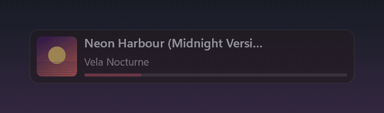
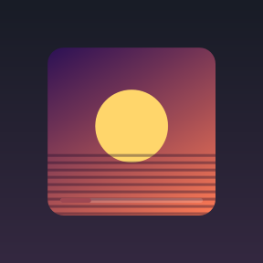
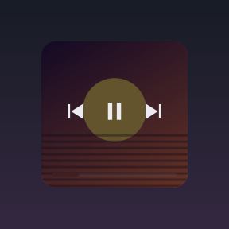
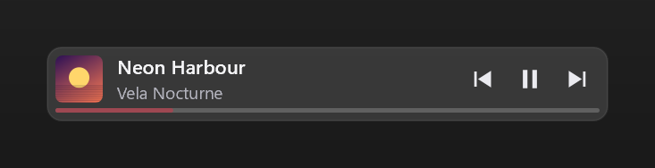
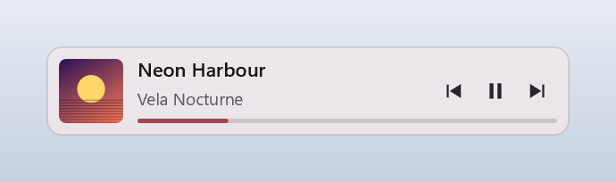
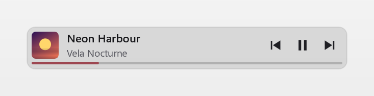

# MiniBar

[](https://github.com/AceisX/minibar-now-playing-overlay/actions/workflows/build.yml)

*[Leggi in italiano](README.it.md)*

**The lightest music overlay for Windows 11.** ~6 MB of RAM, a sub-300 KB executable, no GPU
work between redraws, and not a single hook or injected DLL — so it is safe to run next to
an anti-cheat.



MiniBar reads the media session that Windows already knows about, so it works with whatever
you play music in — Spotify, Tidal, YouTube Music in a browser, foobar2000, the Windows
media player. No account, no API key, no plugin, nothing to log into.

## Why it is small

Most "now playing" widgets are web apps in a costume: an Electron shell, or a .NET runtime,
or a WebView. MiniBar is a Win32 window that rasterizes with Direct2D in software and
presents with `UpdateLayeredWindow`. There is no render loop: it redraws when something
changes and sleeps in the message loop the rest of the time.

| | Measured |
|---|---|
| RAM (private working set) | **~6 MB** |
| Executable | **295 KB**, no runtime to install |
| CPU at rest | **0.0 %** in Task Manager (hundredths of a core) |
| GPU between redraws | **0 %** — there is no GPU device at all |
| Cold start to visible bar | **~50 ms** (~110 ms the very first run, before the file cache is warm) |

It also never touches another process. No DLL injection, no DirectX or Vulkan hooks, no
global `SetWindowsHookEx`. Everything it knows about other applications it learns through
public, out-of-process APIs — the same ones the Windows volume flyout uses. That is a
deliberate design constraint, because those are exactly the patterns that anti-cheat
systems flag.

**Why there is no comparison table here.** The obvious question is how this compares to
the alternatives, and the honest answer is that we could not measure them under conditions
we would be willing to publish. The closest projects are distributed in ways that do not
fit a portable, no-install test: [ModernFlyouts](https://github.com/ModernFlyouts-Community/ModernFlyouts)
(WinUI/.NET) ships only as an MSIX package, and its last release is 0.9.3 from April 2021;
[lofi](https://github.com/dvx/lofi) (Electron) ships a Windows installer that writes
uninstall entries to the registry, and needs a Spotify login before it displays anything;
[Rainmeter](https://github.com/rainmeter/rainmeter) is a skin engine rather than a
now-playing app, and the skins it bundles include no now-playing skin at all, so any
measurement would really be measuring somebody's third-party skin. Rather than publish
numbers we did not measure ourselves, we publish only ours — and the method to reproduce
them: private working set and CPU sampled over 60 seconds with music playing and the mouse
away from the bar, on Windows 11 25H2.

## Install

1. Download `minibar.exe` from the [latest release](https://github.com/AceisX/minibar-now-playing-overlay/releases/latest).
2. Put it wherever you like and run it.

That is the whole procedure. The executable is self-contained — static CRT, no VC++
redistributable, no DLLs next to it — and it is portable: the only file it ever writes is
`minibar.ini`, right beside itself. Nothing goes into AppData or the registry.

With [Scoop](https://scoop.sh):

```powershell
scoop bucket add aceisx https://github.com/AceisX/scoop-bucket
scoop install minibar
```

`winget install minibar` is on its way: the manifest is submitted to the community
repository and will appear once it is merged.

**Requirements:** Windows 11 x64. Nothing else.

## Three modes

|  | Overlay | Docked | In the taskbar |
|---|---|---|---|
| Position | anywhere, drag it | strip along a screen edge | in the taskbar's empty space |
| Reserves screen space | no | yes — maximized windows respect it | no |
| Click-through at rest | yes | no | no |
| Opacity at rest | reduced (`idle_opacity`) | full | full |
| Controls | on hover | always | always |
| Over fullscreen-windowed games | yes | no | yes, while the taskbar is visible |
| Looks available | bar or tile | bar | compact pill |
| Default footprint | 293×50 or 92×92 DIP | 50 DIP tall, 56 DIP wide on a side edge | taskbar height |

**Overlay**, the bar look — drag it anywhere, click-through and dimmed until you hover it.
Whenever it appears — at startup, when you bring it back from the tray or the hotkey, or
when you switch into overlay mode — it shows itself at full opacity for a couple of seconds
before dimming, so you can find it even with the idle opacity turned way down:


**Overlay**, the tile look — just the cover and a progress line; the controls appear over it
on hover:

 

**Docked** — a strip along a screen edge, with space reserved: maximized windows stop above
it instead of hiding it. Any of the four edges, from **Edge** in the menu.


On the left and right edges the strip is narrow and tall, so it uses a column layout
instead: cover, progress, and the three controls stacked, centred vertically. There is no
text there — 56 DIP is not enough for a title, and rotating it would be worse than leaving
it out.

**In the taskbar** — a pill in the empty space. It follows the taskbar's height, edge, DPI
and theme, widens on hover to show title and artist, and disappears together with the
taskbar when it auto-hides or a fullscreen app takes over.



Switch mode and look from the right-click menu, or from the tray icon.

## Using it

| What | How |
|---|---|
| Show the controls | hover the bar |
| Play/pause, previous, next | click the buttons |
| Seek | click the progress bar (if the player allows it) |
| Move the bar | drag it (overlay only); the position is saved |
| **Player volume up/down** | **mouse wheel over the bar** |
| **Mute the player** | **middle-click the bar** |
| Resize | **Ctrl** + wheel over the bar (overlay only), or `bar_width` / `tile_size` in the INI |
| Change mode or look | right-click → Mode / Look |
| Move the docked strip to another edge | right-click → Edge (Bottom / Top / Left / Right) |
| Choose which player to follow | right-click → Player; the one you leave pauses, the one you pick starts |
| Light or dark | right-click → Theme (Follow Windows / Dark / Light) |
| Dim it more or less at rest | right-click → Idle opacity (overlay only) |
| Start with Windows | right-click → Start with Windows |
| Menu | right-click the bar, or the tray icon |
| Show/hide | double-click the tray icon, or the hotkey if enabled |

Everything in that menu is also a line in `minibar.ini`, and the file stays the place for the
details — exact sizes, hotkey, docking edge. The menu covers what you actually change while
using it.

The wheel (volume and resizing) relies on the Windows setting "scroll inactive windows when
I hover over them", which is on by default.

### Starting with Windows, without the registry

**Start with Windows** puts a shortcut in your Startup folder — the one you can open with
`shell:startup` — pointing at wherever `minibar.exe` currently is. Nothing is written to the
registry, nothing is installed, and you can delete that shortcut by hand without MiniBar
getting confused: the menu reads the checkbox state from whether the file exists, not from a
setting of its own.

### The volume is the player's, not the system's

MiniBar moves the player's own slider in the Windows mixer, so nothing else on your machine
changes volume. Which process that is comes from the media session itself: its
`SourceAppUserModelId` is matched against the owner of every mixer session, by executable
name or by package identity for Store apps.

If the player has no audio session — not running, or it has never made a sound — there is
nothing to move, and the wheel goes back to resizing the bar without needing Ctrl. The level
shows for a second and a half on the progress bar itself, in a light color instead of the
album color: no panel appears, no extra pixel is occupied.

The Core Audio interfaces are created the first time you use the wheel, not at startup. If
you never touch the volume, you never pay for it.

### Two players at once

Anything that registers a media session shows up under **Player** in the menu — including a
video in a browser tab. Pick one and MiniBar follows it; pick **Automatic** and it follows
whatever Windows considers current.

Browsers appear under their real name. Firefox and web apps register their media session
under an opaque identifier — Firefox uses a hexadecimal hash of its install path — which
resembles no process name and would leave the menu showing something like `F9EA399AADDF5B80`.
MiniBar asks the desktop's windows which identifier they declare, finds the one that
matches, and takes the name the executable gives itself. That is also what makes the volume
wheel and the minimize work for a browser: without it, there is no way to tell which process
that identifier belongs to.

When you switch, the player you are leaving is paused and the one you pick starts, so
switching player means what you would expect it to mean: the music moves. The comparison is
between the player followed before and the one followed after, not between menu entries: if
the choice lands on the same player, nobody is being left behind and nothing is touched.

Two details that keep this from being annoying. Pausing applies to every session of the app
you leave — a browser can have several — while starting applies only to the one session
MiniBar is now following, because starting three paused tabs at once would be worse than the
problem it solves. And if the new player says it cannot start right now, MiniBar does not
insist. Both halves can be turned off separately, from the menu or with `pause_on_switch`
and `play_on_switch`.

### It gets the player out of the way

While MiniBar is running, the player's window is minimized (configurable), so it is not in
the way: you keep the screen and you keep the controls. Whether that also saves resources
depends on the player, and you should not count on it — we measured Spotify on Windows 11
25H2, and with the window minimized its RAM does not change and its CPU does not go down.
The number that holds is MiniBar's own cost, in the table above.

The window is **always** restored when MiniBar exits. If a previous run died badly with the
window hidden, the next start recovers it: the marker left on disk also records which player
it was.

## The color comes from the album

The progress bar — and a breath of the background — take the cover's dominant color. A
12×12 thumbnail is scaled by WIC alongside the cover being drawn, and the hue band with the
most weight wins: every pixel counts for how saturated it is, greys and extremes count for
nothing, and neighbouring bands are summed so a color straddling two of them does not lose
half its weight. The result is pushed into a saturation and lightness range that stays
legible on whatever it lands on.

Covers without a real color — black and white, busy collages — tint nothing and the default
green stays. The whole thing costs 144 pixels, once per track.

## Configuration

On first run `minibar.exe` writes `minibar.ini` next to itself.

```ini
[general]
mode=overlay          ; overlay | docked | taskbar
theme=auto            ; auto | dark | light — auto follows the Windows app theme,
                      ; live, no restart; over a game you may want dark regardless
preferred_app=Spotify ; substring of the media session's SourceAppUserModelId;
                      ; empty = follow whatever Windows considers current.
                      ; Also settable from the menu: right-click → Player

[overlay]
layout=bar            ; bar (horizontal strip) | tile (square, cover only)
bar_width=293         ; DIP, 185-840
tile_size=92          ; DIP, 68-224
x=…  y=…              ; written when you drop the bar after a drag
idle_opacity=140      ; 0-255, opacity at rest

[docked]
edge=bottom           ; bottom | top | left | right

[taskbar]
anchor=auto           ; auto | left | center | right
                      ; auto: left when app icons are centered,
                      ;       center when they are left-aligned

[player]              ; called [spotify] until 1.0; old files are still read
auto_minimize=1       ; minimize the player when MiniBar starts
hide_instead=0        ; 1 = SW_HIDE instead of SW_MINIMIZE (more aggressive)
launch_if_missing=0   ; start the player if it is not running
launch_path=          ; executable to start; empty = guessed from the player's name
pause_on_switch=1     ; pause the player you leave when you switch from the menu
play_on_switch=1      ; and start the one you pick, if it was not already playing

[volume]
wheel_step=4          ; volume percentage points per wheel notch, 1-25

[hotkey]
enabled=0
modifiers=alt+shift
key=M
```

## Implementation notes

The full design document — the idea, the hard constraints, the performance budget and the
reasoning behind every choice — is [docs/design.md](docs/design.md) (in Italian).

### Software rendering instead of DirectComposition

The obvious way to draw a translucent always-on-top window is a DXGI composition swapchain
plus DirectComposition. That was built first, then measured against the simpler fallback —
Direct2D rasterizing in software into a WIC bitmap, presented with `UpdateLayeredWindow`:

| | D3D11 + DXGI + DirectComposition | D2D software + UpdateLayeredWindow |
|---|---|---|
| Private memory | 37.7 MB | **8.7 MB** |
| Private working set | ~34 MB | **6.1 MB** |
| Threads | 26–29 | **10–12** |
| Handles | ~1120 | **~320** |
| CPU at rest | 0.29 % of a core | **0.10 % of a core** |

A D3D11 device and its driver cannot be amortized over a 266×45 surface redrawn at most once
a second. Software rasterization of that surface costs fractions of a millisecond and never
touches the GPU, which makes "0 % GPU between redraws" structural rather than hoped for.

### Long titles scroll, but only under the mouse

A title that does not fit is truncated with an ellipsis, like anywhere else. Hover it and it
starts scrolling — out, pause, back — fading at the edges instead of being cut off. The fade
only appears on the side where the text actually continues: once it reaches the end, the
right edge is crisp again.

The timer that animates it is created when the mouse enters and destroyed when it leaves,
and it is not created at all if the title fits. A scrolling redraw costs 0.64 ms against
0.39 ms still — under 2 % of a core while you hover, nothing when you do not.

### Transitions last as long as they need, then the timer is gone

On a track change the new cover fades in over the old one in 220 ms, and the progress bar's
tint travels with it — a color that snapped while the image was still dissolving would be
more noticeable than the dissolve. In the taskbar the pill eases open instead of jumping.

Every transition — hover opacity, cover, pill — runs on one 16 ms timer that starts when
something begins moving and stops the moment everything is still. The at-rest measurements
before and after adding them are identical, which is the whole point.

### Light or dark: two settings, not one

Windows keeps two separate values and MiniBar uses them for two different things.
`SystemUsesLightTheme` is the shell's color, so the taskbar's: it decides the contrast of
the pill sitting on it. `AppsUseLightTheme` is what applications should follow when they
draw themselves, and it decides the background MiniBar paints in overlay and docked mode. On
Windows 11 you can have a dark taskbar with light apps, and then the two should not match.

 

The change is applied live on `WM_SETTINGCHANGE`: both values are re-read and the bar is
redrawn, without recreating anything. `theme=dark` or `theme=light` in the INI overrides it.

### Taskbar mode is not a deskband

Drawing *inside* the taskbar, as deskbands (`IDeskBand`) used to, requires Explorer to load a
DLL into its own process. Windows 11 removed that mechanism — the taskbar is XAML and hosts
no third-party extensions — and it would be injection anyway.

What MiniBar does is put its own topmost window *over* the taskbar's free pixels. Visually
it is indistinguishable; technically it stays a separate window, so it does not scroll along
with the app icons. To find free space it reads `TaskbarAl` (the icon alignment) and the
rectangle of `TrayNotifyWnd` (where the notification area begins), both read-only and
out-of-process. It registers as an appbar with `ABM_NEW` but **never** calls `ABM_SETPOS`, so
it receives `ABN_POSCHANGED`, `ABN_STATECHANGE` and `ABN_FULLSCREENAPP` without taking screen
space away.

Taskbar app icons on Windows 11 are not windows and cannot be enumerated: the position comes
from the alignment the system declares, not from measuring where the buttons end. With very
many windows open and left alignment, a centered pill can end up over them; use `anchor=right`
in that case.

### What it will not do

Over an *exclusive* fullscreen game the overlay is not visible. That is by design and there
is no workaround here — that is what the Windows Game Bar is for. Borderless windowed, which
is what most games use now, works.

## Building it

You need nothing installed: the toolchain lives in `tools\` and is portable, like the
application.

```powershell
.\build.ps1                 # Release (default)
.\build.ps1 -Config debug
.\build.ps1 -Clean          # from scratch
```

The executable lands in `dist\minibar.exe`. To rebuild the toolchain itself on another
machine, see [README.it.md](README.it.md).

## License

MIT — © 2026 MiniBar contributors. See [LICENSE](LICENSE).
